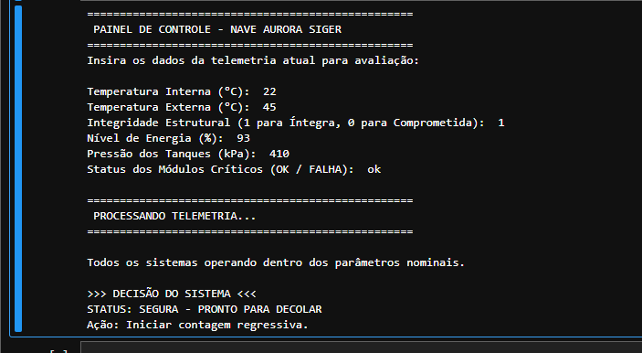
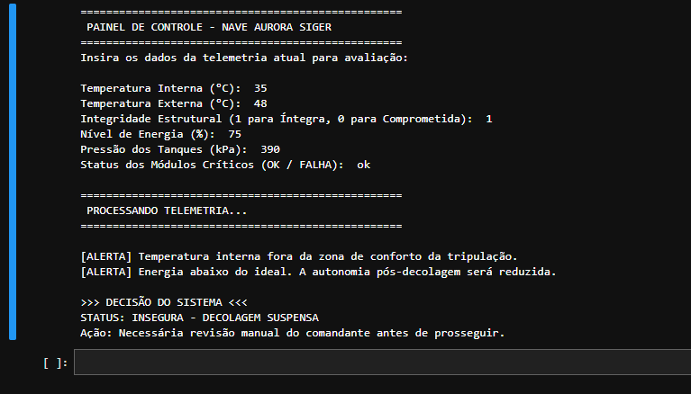

# Missão Aurora Siger - Sistema de Validação de Pré-Decolagem

Este repositório contém o script de automação e os registros de execução referentes ao sistema de validação de pré-decolagem da Missão Aurora Siger. O projeto visa processar dados críticos de telemetria, aplicando lógicas condicionais para autorizar, suspender ou abortar o lançamento com base em diretrizes estritas de segurança aeroespacial.

## Conteúdo do Repositório

O repositório é composto exclusivamente pelos seguintes arquivos:

*   **Arquivo de Código (`.ipynb` ou `.py`):** Script iterativo que simula o painel de controle da nave.
*   `execucao-sucesso.png`: Registro da execução do script resultando em status nominal (Decolagem Segura).
*   `execucao-falha.png`: Registro da execução do script resultando em status de alerta (Decolagem Suspensa).

## Parâmetros de Telemetria Avaliados

O algoritmo realiza a validação das seguintes variáveis operacionais:

1.  **Temperatura Interna (°C):** Faixa nominal de 18.0 a 26.0.
2.  **Temperatura Externa (°C):** Limites operacionais de -100.0 a 150.0.
3.  **Integridade Estrutural:** Requisito booleano rigoroso (1 = Íntegra; 0 = Comprometida).
4.  **Nível de Energia (%):** Limite mínimo exigido de 85% para a ignição.
5.  **Pressão dos Tanques (kPa):** Faixa de estabilidade estipulada entre 350.0 e 450.0.
6.  **Status dos Módulos Críticos:** Requisito de string exata ("OK").

Qualquer desvio absoluto em integridade, status dos módulos ou variação térmica externa extrema resulta em falha crítica e aborto imediato. Desvios toleráveis geram alertas cumulativos que podem suspender o lançamento, exigindo intervenção manual.

## Instruções de Execução

1.  Certifique-se de possuir um ambiente de desenvolvimento Python 3.x configurado (Jupyter Lab, Google Colab ou terminal padrão).
2.  Clone o repositório em sua máquina local.
3.  Execute o script principal.
4.  Insira os dados numéricos e de texto conforme solicitado pelo terminal interativo para simular a telemetria atual.
5.  O sistema processará os dados e retornará o diagnóstico operacional.

## Registros de Execução

Abaixo estão os registros visuais da validação do script sob diferentes cenários de telemetria.

### Cenário 1: Operação Nominal
Execução em que todas as variáveis se encontram dentro das faixas seguras estabelecidas, resultando na autorização para o início da contagem regressiva.

### Cenário 2: Operação Insegura (Múltiplos Alertas)
Execução em que não há falhas críticas, porém o sistema registra múltiplos alertas (temperatura interna elevada e nível de energia abaixo do ideal), resultando na suspensão automática da decolagem.

